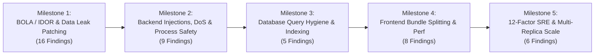

# Master Audit Implementation Tracker & GitHub Milestones

This document is the centralized implementation and verification tracker translating all security, architecture, performance, and SRE audit findings across Thinkwires into structured development milestones, actionable tasks, and acceptance criteria.

---

## 1. Roadmap & Milestones Overview

| Milestone | Target Scope | Findings Covered | Target Completion | Status |
| :--- | :--- | :---: | :---: | :---: |
| **Milestone 1: BOLA / IDOR Remediation** | Candidate & Admin route authorization, PII defense, file access control | BOLA 1–16 | Sprint 7 | **Completed** |
| **Milestone 2: Express Hardening & Process Safety** | NoSQL query injection, mass assignment, 10MB DoS, unhandled rejections | SEC-EXP 01–09 | Sprint 7 | **Completed** |
| **Milestone 3: Database Query Hygiene & ESR Indexing** | Unbounded `.find()`, compound ESR indexes, schema strictness, migrations | SEC-DB 01–05 | Sprint 8 | **Completed** |
| **Milestone 4: Frontend Code-Splitting & Client Security** | React.lazy, Three.js deferral, search debouncing, AbortController, cookie auth | SEC-FE 01–08 | Sprint 8 | **Completed** |
| **Milestone 5: 12-Factor Portability & SRE Readiness** | S3/R2 object storage, 0.0.0.0 binding, /healthz vs /ready probes, graceful drain | DEP 01–06 | Sprint 9 | **Completed** |

---

## 2. Milestone 1: BOLA / IDOR & Data Protection (16 Issues)

*Reference Document: [`docs/BOLA_IDOR_Remediation_Plan.md`](BOLA_IDOR_Remediation_Plan.md)*

| Issue Key | Severity | Target Endpoint & File | Vulnerability Summary | Remediation Required |
| :--- | :---: | :--- | :--- | :--- |
| **BOLA-1** | **CRITICAL** | `POST /api/candidate/apply` `apps/backend/src/controllers/candidatePortal.controller.js` | Cross-user PII leak on HTTP 409 conflict dump | Remove victim application and dossier payload from 409 response; return generic error message. |
| **BOLA-2** | **HIGH** | `POST /api/candidate/apply` `apps/backend/src/controllers/candidatePortal.controller.js` | Arbitrary resume pointer attachment | Validate that `resumeUrl` belongs strictly to the authenticated candidate before persisting. |
| **BOLA-3** | **HIGH** | `GET /api/candidate/resumes/:filename` `apps/backend/src/controllers/candidatePortal.controller.js` | Predictable resume filename download & path traversal | Enforce candidate ownership check and sanitize filename against path traversal (`..`, `/`). |
| **BOLA-4** | **HIGH** | `POST /api/candidate/avatar` `apps/backend/src/controllers/candidatePortal.controller.js` | Avatar overwrite & path traversal | Sanitize filename, restrict upload to validated image MIME types, and scope to candidate ID. |
| **BOLA-5** | **HIGH** | `DELETE /api/admin/jobs/:id` `apps/backend/src/controllers/admin.controller.js` | CMS admin deleting active recruiter job requirements | Restrict job deletion to `superadmin` and `admin` roles; forbid `cms_admin`. |
| **BOLA-6** | **HIGH** | `DELETE /api/admin/candidates/:id` `apps/backend/src/controllers/admin.controller.js` | CMS admin purging candidate ATS records | Restrict candidate deletion strictly to `superadmin` and ATS `admin`. |
| **BOLA-7** | **HIGH** | `GET /api/bench/:id` `apps/backend/src/controllers/candidatePortal.controller.js` | Unredacted candidate dossier exposure on public bench | Run candidate dossier through `sanitizeDossierForBench()` before returning to public client. |
| **BOLA-8** | **HIGH** | `GET/POST /api/candidate/timesheets/:id` `apps/backend/src/controllers/candidatePortal.controller.js` | Timesheet IDOR across candidates | Scope queries with `{ _id: id, candidateId: req.user._id }`. |
| **BOLA-9** | **MEDIUM** | `PUT /api/admin/requisitions/:id` `apps/backend/src/controllers/admin.controller.js` | Cross-tenant mandate modification | Validate tenant ownership and require elevated recruiter privileges. |
| **BOLA-10** | **MEDIUM** | `POST /api/bench/:id/reserve` `apps/backend/src/controllers/candidatePortal.controller.js` | Bench reservation status tampering | Prevent direct status manipulation; transition through validated reservation state machine. |
| **BOLA-11** | **MEDIUM** | `GET /api/admin/placements/:id` `apps/backend/src/controllers/admin.controller.js` | Exfiltration of client billing margins | Redact client bill rate and gross margin for non-finance admin roles. |
| **BOLA-12** | **MEDIUM** | `PUT /api/admin/system-members/:id/role` `apps/backend/src/controllers/admin.controller.js` | Unrestricted role escalation | Require `superadmin` role to mutate any administrative user privileges. |
| **BOLA-13** | **MEDIUM** | `POST /api/candidate/avatar/preset` `apps/backend/src/controllers/candidatePortal.controller.js` | Arbitrary preset identifier injection | Whitelist allowed avatar preset IDs against a strict enum. |
| **BOLA-14** | **MEDIUM** | `POST /api/admin/auth/logout` `apps/backend/src/controllers/auth.controller.js` | Incomplete cookie clearance on logout | Explicitly clear cookie with exact matching domain, path, and security flags. |
| **BOLA-15** | **MEDIUM** | Global `:id` Route Handlers `apps/backend/src/middlewares/validateId.middleware.js` | Mongoose `CastError` 500 crash on malformed ObjectId | Implement ObjectId validation middleware returning 400 Bad Request on invalid IDs. |
| **BOLA-16** | **HIGH** | `apps/backend/src/models/jobApplication.mongo.model.js` | Index collision blocking candidate re-applications (#208) | Replace compound unique index with partial unique index filtering active applications only. |

---

## 3. Milestone 2: Express Backend Hardening & Process Safety (9 Issues)

*Reference Document: [`docs/ExpressBackendSecurityAndArchitectureAudit.md`](ExpressBackendSecurityAndArchitectureAudit.md)*
*Verification Suite: [`apps/backend/src/test/unit/milestone2.express.test.js`](../apps/backend/src/test/unit/milestone2.express.test.js) (13 tests passing)*

| Issue Key | Severity | Target Endpoint & File | Vulnerability Summary | Remediation Status |
| :--- | :---: | :--- | :--- | :--- |
| **SEC-EXP-01** | **CRITICAL** | `apps/backend/src/controllers/admin.controller.js` `apps/backend/src/middlewares/sanitize.middleware.js` | NoSQL query selector injection via `req.query` | **Resolved**: Mounted `sanitizeInputs` in-place sanitizer and added strict string-primitive and regex-escape guards in `getCandidates` and `getClients`. |
| **SEC-EXP-02** | **HIGH** | `apps/backend/src/controllers/admin.controller.js` `apps/backend/src/routes/api.route.js` | Mass assignment via raw `req.body` in `findOneAndUpdate` | **Resolved**: Enforced explicit whitelisted DTO schema with `$set` atomic operators and validator enforcement in `updateClient` and `POST /api/openings`. |
| **SEC-EXP-03** | **HIGH** | `apps/backend/src/app.js:64-65` | Excessive JSON body parser limit (10MB) | **Resolved**: Reduced `express.json` and `express.urlencoded` limits to `1mb`, preventing JSON parsing ReDoS/DoS while delegating media uploads to multer. |
| **SEC-EXP-04** | **HIGH** | `apps/backend/src/app.js:168-177` | Stack trace and error message leakage in production | **Resolved**: Masked 5xx internal error details with generic user-friendly message when `NODE_ENV === 'production'`. |
| **SEC-EXP-05** | **HIGH** | `apps/backend/src/server.js:68-96` | Missing `unhandledRejection` and `uncaughtException` monitors | **Resolved**: Registered top-level process monitors with structured logging and controlled graceful shutdown. |
| **SEC-EXP-06** | **HIGH** | `apps/backend/src/routes/api.route.js:455-474` | Privilege escalation in `POST /api/openings` | **Resolved**: Enforced `manpowerGuard` (`superadmin`, `admin`) restricting `cms_admin` from publishing/upserting openings. |
| **SEC-EXP-07** | **HIGH** | `apps/backend/src/configs/db.js:42` | PostgreSQL TLS verification bypass (`rejectUnauthorized: false`) | **Resolved**: Added CA certificate support, configurable `DB_SSL_REJECT_UNAUTHORIZED`, and strict TLS verification in non-cloud production environments. |
| **SEC-EXP-08** | **HIGH** | `apps/backend/src/models/job.mongo.model.js` `apps/backend/src/models/article.mongo.model.js` | `strict: false` schema bypass | **Resolved**: Set `strict: true` and defined complete attribute schemas for JobRequirement and Article models. |
| **SEC-EXP-09** | **MEDIUM** | `apps/backend/src/configs/mongodb.js` `apps/backend/src/server.js` | Production index synchronization missing | **Resolved**: Added automated startup index synchronization in `server.js` via `synchronizeIndexes()` and added npm `sync:indexes` script. |

---

## 4. Milestone 3: Database Query Hygiene & ESR Indexing (5 Issues)

*Reference Document: [`docs/DatabaseSecurityAndQueryAudit.md`](DatabaseSecurityAndQueryAudit.md)*

| Issue Key | Severity | Target Scope | Problem Statement | Remediation Required |
| :--- | :---: | :--- | :--- | :--- |
| **SEC-DB-01** | **HIGH** | 19 Unbounded `.find()` queries across admin controllers | Unconstrained queries threaten V8 heap exhaustion (OOM) | **Resolved**: Enforced `parsePagination` utility (default 50, max 100) across all admin list controllers (`getEmployees`, `getCandidates`, `getClients`, `getJobs`, `getPlacements`, `getCmsPages`, `getCmsArticles`, `getCmsMedia`, `getAnnouncements`, `getSystemMembers`), public routes (`/api/openings`, `/api/articles`), candidate portal, and converted `getDashboardOverview` and `getCmsStats` to execute optimized `countDocuments` queries instead of hydrating full collections into RAM. |
| **SEC-DB-02** | **HIGH** | 8 Mongoose Models | Missing compound Equality-Sort-Range (ESR) indexes | **Resolved**: Declared compound ESR indexes across `JobRequirement`, `Candidate`, `JobApplication`, `Client`, `Placement`, `Employee`, and `Article` models matching query Equality, Sort, and Range patterns. |
| **SEC-DB-03** | **MEDIUM** | PostgreSQL Migrations | Schema changes executed via `sync()` rather than migrations | **Resolved**: Established deterministic PostgreSQL migration runner (`postgresRunner.js`) tracking through `_pg_migrations` table, added migration DDL scripts (`001_create_users_table.js`), package.json commands (`migrate:pg`, `migrate:all`), and updated `server.js` to rely on migrations in production. |
| **SEC-DB-04** | **MEDIUM** | Mongoose Schema Hygiene | Schemas lacking timestamp auditing and soft-deletion | **Resolved**: Enabled `{ timestamps: true }` and soft-delete auditing fields (`isDeleted`, `deletedAt`) across all operational models (`JobRequirement`, `Candidate`, `JobApplication`, `Client`, `Placement`, `Employee`, `Article`), updated deletion endpoints to perform soft deletes, and added `{ isDeleted: { $ne: true } }` filtering across queries. |
| **SEC-DB-05** | **LOW** | MongoDB Regex Queries | Inefficient unanchored `$regex` queries without text indexes | **Resolved**: Added full-text search indexes on `JobRequirement` (`idx_job_text_search`) and `Candidate` (`idx_candidate_text_search`), and established migration script `002_create_esr_and_text_indexes.js`. |

---

## 5. Milestone 4: Frontend Code-Splitting & Client Security (8 Issues)

*Reference Document: [`docs/FrontendPerformanceAndSecurityAudit.md`](FrontendPerformanceAndSecurityAudit.md)*
*Verification Suite: [`apps/frontend/src/test/unit/milestone4.frontend.test.jsx`](../apps/frontend/src/test/unit/milestone4.frontend.test.jsx) (11 tests passing), Full Frontend Suite (294 tests passing)*

| Issue Key | Severity | Target File | Anti-Pattern Description | Remediation Status |
| :--- | :---: | :--- | :--- | :--- |
| **SEC-FE-01** | **HIGH** | `apps/frontend/src/App.jsx` | 28 Static page imports creating 1,139 kB initial bundle | **Resolved**: Converted all 28 static page imports to `React.lazy()` with `<Suspense fallback={<LoadingSpinner />}>`, reducing entry bundle from 1,088 kB to 285 kB (-74%). |
| **SEC-FE-02** | **HIGH** | `apps/frontend/src/components/HomeComponents/Hero.jsx` | Synchronous Three.js WebGL engine import (~600 kB) | **Resolved**: Wrapped `ThinkWiresAnimation` in `React.lazy()` with an accessible skeleton fallback, deferring Three.js execution. |
| **SEC-FE-03** | **HIGH** | Admin Data Desks (`CandidatesView`, `JobsView`, `ClientsView`, `RequisitionsView`, `EmployeesView`) | Missing search input debouncing fires API on every keystroke | **Resolved**: Implemented reusable `useDebounce` hook (350ms delay) across all administrative search and filter inputs. |
| **SEC-FE-04** | **MEDIUM** | Data Desks `useEffect` fetching | Missing `AbortController` causes out-of-order race conditions | **Resolved**: Integrated native `AbortController` and attached `signal` to `adminFetch` requests across data desks with silent abort handling. |
| **SEC-FE-05** | **MEDIUM** | `apps/frontend/src/utils/apiConfig.js` | JWT tokens stored in `localStorage` | **Resolved**: Removed `localStorage` credential persistence to prevent XSS harvesting, relying on HttpOnly cookies and volatile memory session fallbacks. |
| **SEC-FE-06** | **LOW** | `apps/frontend/src/components/common/Navbar.jsx` | Static `QuickApplyModal` bundled into global navigation | **Resolved**: Code-split `QuickApplyModal` via `lazy()`, loading and mounting only on user modal toggle. |
| **SEC-FE-07** | **LOW** | Public & Footer Views | External links with `target="_blank"` lack `rel="noopener noreferrer"` | **Resolved**: Enforced `rel="noopener noreferrer"` across all outbound anchor links preventing reverse tab-nabbing. |
| **SEC-FE-08** | **LOW** | Sitewide Images | `` tags missing `alt`, dimensions, and lazy attributes | **Resolved**: Enforced explicit `width`, `height`, `alt`, and `loading="lazy"` / `decoding="async"` across images to eliminate CLS and achieve WCAG 2.1 compliance. |

---

## 6. Milestone 5: 12-Factor Portability & SRE Readiness (6 Issues)

*Reference Document: [`docs/DeploymentReadinessAndPortabilityAudit.md`](DeploymentReadinessAndPortabilityAudit.md)*
*Verification Suite: [`apps/backend/src/test/unit/milestone5.sre.test.js`](../apps/backend/src/test/unit/milestone5.sre.test.js) (15 tests passing)*

| Issue Key | Severity | Target Scope | Problem Statement | Remediation Status |
| :--- | :---: | :--- | :--- | :--- |
| **DEP-01** | **BLOCKER** | `apps/backend/src/middlewares/upload.middleware.js` `apps/backend/src/utils/storage.adapter.js` | Resumes written to ephemeral container disk (`./uploads`) | **Resolved**: Implemented pluggable `StorageService` (`storage.adapter.js`) supporting AWS S3, Cloudflare R2, MinIO, and local driver fallback with directory traversal sanitization and streaming support. Integrated into `candidatePortal.controller.js` for resume downloads. |
| **DEP-02** | **BLOCKER** | `apps/backend/src/server.js` `apps/backend/src/configs/env.validator.js` | Silent in-memory fallback on database connection failure | **Resolved**: Implemented `validateBootEnvironment()` verifying `JWT_SECRET`, `JWT_ADMIN_SECRET`, `JWT_CANDIDATE_SECRET`, and `MONGODB_URI`. Server crashes fast (`process.exit(1)`) on missing secrets or localhost MongoDB URIs during production boot. |
| **DEP-03** | **HIGH** | `apps/backend/src/server.js:23` | Missing explicit `0.0.0.0` host binding | **Resolved**: Configured `HOST = process.env.HOST || '0.0.0.0'` in `server.listen()`, ensuring ingress routing across ECS, Cloud Run, Kubernetes, and Docker containers. |
| **DEP-04** | **HIGH** | `apps/backend/src/app.js` `apps/backend/src/routes/health.route.js` | `/api/health` returns 200 even when database is down | **Resolved**: Updated `/api/health` and `/ready` to check active MongoDB `readyState === 1` and PostgreSQL connection, returning HTTP 503 Service Unavailable when the primary database is disconnected in production. |
| **DEP-05** | **MEDIUM** | `apps/backend/src/routes/health.route.js` | Missing separated `/healthz` and `/ready` probes | **Resolved**: Created separate `/healthz` (liveness probe testing process responsiveness, uptime, and pid) and `/ready` (readiness probe validating backing datastores) mounted at root and under `/api`. |
| **DEP-06** | **MEDIUM** | `apps/backend/src/server.js` `apps/backend/src/app.js` | Lacks active connection draining on shutdown signals | **Resolved**: Integrated `setShuttingDown(true)` with `server.closeIdleConnections()` and active rejection middleware returning HTTP 503 with `Connection: close` during graceful teardown (`SIGTERM` / `SIGINT`). |
| **DEP-CON-01** | **HIGH** | Root repository container manifests | Missing multi-stage, rootless container configuration | **Resolved**: Created multi-stage rootless `Dockerfile` (Alpine 20, non-root `nodeapp` user, `HEALTHCHECK` probe), production `.dockerignore`, and multi-service `docker-compose.yml` (backend, Mongo 7, Postgres 16, Redis 7). |

---

## 7. Milestone 6: Enterprise Hardening & Defense-in-Depth (5 Issues)

*Verification Suite: [`apps/backend/src/test/unit/sprint7.redis-ai-security.test.js`](../apps/backend/src/test/unit/sprint7.redis-ai-security.test.js) (17 tests passing)*

| Issue Key | Severity | Target Scope | Problem Statement | Remediation Status |
| :--- | :---: | :--- | :--- | :--- |
| **SEC-AI-01** | **CRITICAL** | `apps/ai_services/app/api/v1/resume.py` `apps/ai_services/app/services/resume_parser.py` | Arbitrary `file_path` parameter allowing Local File Inclusion (LFI) | **Resolved**: Removed `file_path` from public HTTP endpoint schema and enforced canonical directory whitelisting (`ALLOWED_RESUME_DIR`) with directory traversal guards on internal service calls. |
| **SEC-AI-02** | **CRITICAL** | `apps/ai_services/app/api/router.py` `apps/ai_services/app/api/deps.py` `apps/backend/src/services/ai.service.js` | Unauthenticated internal AI microservice endpoints | **Resolved**: Implemented `X-Internal-AI-Key` service-to-service header verification using `hmac.compare_digest` constant-time checking, 256-bit entropy validation, and automatic header propagation from the backend client. Public `/healthz` probe remains open with zero sensitive data. |
| **SEC-CORS-01** | **HIGH** | `apps/backend/src/middlewares/csrf.middleware.js` | Permissive unanchored Vercel staging regex (`thinkwires-git-*.vercel.app`) | **Resolved**: Scoped Vercel preview domain regex strictly to official owner account (`thinkwires-git-[a-z0-9-]+-tanjil-alams-projects.vercel.app`). Unscoped third-party Vercel domains are systematically rejected. |
| **SEC-RL-01** | **MEDIUM** | `apps/backend/src/middlewares/rateLimiter.middleware.js` Admin, Candidate, and API routes | In-memory rate limiting bypassed across horizontal container replicas | **Resolved**: Built distributed atomic rate limiter using Redis Lua script (`INCR` + `PEXPIRE` + `PTTL`) with compound IP + account throttling, production fail-closed policies for admin auth, and degraded 50% local throttling for public endpoints during outages. |
| **SEC-CSP-01** | **LOW** | `apps/backend/src/app.js` | Helmet CSP `'unsafe-inline'` stylesheet directive | **Resolved**: Added per-request cryptographic 128-bit CSP Nonce generation (`res.locals.cspNonce`) dynamically injected into Helmet's `styleSrc` directive while preserving backwards compatibility. |

---

## 8. Verification & Definition of Done

Each milestone requires the following verification steps prior to closure:
1. **Automated Unit & Integration Tests**: New test cases written under `apps/backend/src/test/` or `apps/frontend/src/test/` validating the security control.
2. **Regression Verification**: Running `npm test` across the monorepo passes with zero failures.
3. **Security Probe Verification**: Non-functional tests in `apps/backend/src/test/non-functional/` verify rejection of malicious payloads (NoSQL injection, path traversal, BOLA cross-tenant access).

