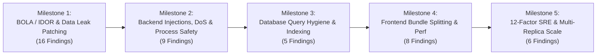

# Master Audit Implementation Tracker & GitHub Milestones

This document is the centralized implementation and verification tracker translating all security, architecture, performance, and SRE audit findings across Thinkwires into structured development milestones, actionable tasks, and acceptance criteria.

---

## 1. Roadmap & Milestones Overview

| Milestone | Target Scope | Findings Covered | Target Completion | Status |
| :--- | :--- | :---: | :---: | :---: |
| **Milestone 1: BOLA / IDOR Remediation** | Candidate & Admin route authorization, PII defense, file access control | BOLA 1–16 | Sprint 7 | **Completed** |
| **Milestone 2: Express Hardening & Process Safety** | NoSQL query injection, mass assignment, 10MB DoS, unhandled rejections | SEC-EXP 01–09 | Sprint 7 | **Completed** |
| **Milestone 3: Database Query Hygiene & ESR Indexing** | Unbounded `.find()`, compound ESR indexes, schema strictness, migrations | SEC-DB 01–05 | Sprint 8 | **Completed** |
| **Milestone 4: Frontend Code-Splitting & Client Security** | React.lazy, Three.js deferral, search debouncing, AbortController, cookie auth | SEC-FE 01–08 | Sprint 8 | **Completed** |
| **Milestone 5: 12-Factor Portability & SRE Readiness** | S3/R2 object storage, 0.0.0.0 binding, /healthz vs /ready probes, graceful drain | DEP 01–06 | Sprint 9 | **Completed** |
| **Milestone 6: Enterprise Hardening & Defense-in-Depth** | AI Microservice Auth, Redis Distributed Rate Limiting, CORS & CSP Nonce | SEC-AI, SEC-CORS, SEC-RL | Sprint 7 | **Completed** |
| **Milestone 7: Cloud Storage & Candidate CSRF Hardening** | S3 SDK Integration & Pre-Signed URLs, Candidate CSRF Double-Submit Token, DB TLS & Port Confinement | SEC-STA-01, SEC-CSRF-02, NV-DB-01, NV-NET-01 | Sprint 8 | **Completed** |
| **Milestone 8: Low-Bandwidth & Network Resilience Engine** | HTTP Gzip Compression, ETag 304 Caching, Exponential-Backoff Fetch Retry, Adaptive 3D Throttling, Form Auto-Save | NET-RES-01–05 | Sprint 9 | **Completed** |
| **Milestone 9: Resume Upload & Object Storage Integration** | Direct S3 persistence via saveFile, MongoDB object key isolation, pre-signed downloads, temp file cleanup, upload failure atomicity | RES-STA-01–05 | Sprint 10 | **Completed** |
| **Milestone 10: CSRF & Cross-Site Cookie Architecture Unification** | SameSite=None; Secure cookie sync, shared custom domain support, timingSafeEqual double-submit, multi-path logout clearance | SEC-CSRF-03–06 | Sprint 10 | **Completed** |
| **Milestone 11: File Upload Validation & Malware Defense Engine** | Magic-byte checking, malware/web shell signature scanning, DOCX zip bomb & Zip Slip defense, PDF structure/action bounds, quarantine isolation | SEC-03-A–E | Sprint 10 | **Completed** |
| **Milestone 12: Redis Fallback Behavior & Distributed Resilience** | Security-critical fail-closed revocation, structured degradation alerting, explicit rate-limit scope headers, 50% tightened local memory policy | SEC-04-A–E | Sprint 10 | **Completed** |
| **Milestone 13: Reverse Proxy Trust & Network Topology Hardening** | Subnet range compilation (loopback, linklocal, uniquelocal), Cloudflare CIDR support, hop count parsing, client IP anti-spoofing | SEC-05-A–D | Sprint 10 | **Completed** |

---

## 2. Milestone 1: BOLA / IDOR & Data Protection (16 Issues)

*Reference Document: [`docs/BOLA_IDOR_Remediation_Plan.md`](BOLA_IDOR_Remediation_Plan.md)*

| Issue Key | Severity | Target Endpoint & File | Vulnerability Summary | Remediation Required |
| :--- | :---: | :--- | :--- | :--- |
| **BOLA-1** | **CRITICAL** | `POST /api/candidate/apply` `apps/backend/src/controllers/candidatePortal.controller.js` | Cross-user PII leak on HTTP 409 conflict dump | Remove victim application and dossier payload from 409 response; return generic error message. |
| **BOLA-2** | **HIGH** | `POST /api/candidate/apply` `apps/backend/src/controllers/candidatePortal.controller.js` | Arbitrary resume pointer attachment | Validate that `resumeUrl` belongs strictly to the authenticated candidate before persisting. |
| **BOLA-3** | **HIGH** | `GET /api/candidate/resumes/:filename` `apps/backend/src/controllers/candidatePortal.controller.js` | Predictable resume filename download & path traversal | Enforce candidate ownership check and sanitize filename against path traversal (`..`, `/`). |
| **BOLA-4** | **HIGH** | `POST /api/candidate/avatar` `apps/backend/src/controllers/candidatePortal.controller.js` | Avatar overwrite & path traversal | Sanitize filename, restrict upload to validated image MIME types, and scope to candidate ID. |
| **BOLA-5** | **HIGH** | `DELETE /api/admin/jobs/:id` `apps/backend/src/controllers/admin.controller.js` | CMS admin deleting active recruiter job requirements | Restrict job deletion to `superadmin` and `admin` roles; forbid `cms_admin`. |
| **BOLA-6** | **HIGH** | `DELETE /api/admin/candidates/:id` `apps/backend/src/controllers/admin.controller.js` | CMS admin purging candidate ATS records | Restrict candidate deletion strictly to `superadmin` and ATS `admin`. |
| **BOLA-7** | **HIGH** | `GET /api/bench/:id` `apps/backend/src/controllers/candidatePortal.controller.js` | Unredacted candidate dossier exposure on public bench | Run candidate dossier through `sanitizeDossierForBench()` before returning to public client. |
| **BOLA-8** | **HIGH** | `GET/POST /api/candidate/timesheets/:id` `apps/backend/src/controllers/candidatePortal.controller.js` | Timesheet IDOR across candidates | Scope queries with `{ _id: id, candidateId: req.user._id }`. |
| **BOLA-9** | **MEDIUM** | `PUT /api/admin/requisitions/:id` `apps/backend/src/controllers/admin.controller.js` | Cross-tenant mandate modification | Validate tenant ownership and require elevated recruiter privileges. |
| **BOLA-10** | **MEDIUM** | `POST /api/bench/:id/reserve` `apps/backend/src/controllers/candidatePortal.controller.js` | Bench reservation status tampering | Prevent direct status manipulation; transition through validated reservation state machine. |
| **BOLA-11** | **MEDIUM** | `GET /api/admin/placements/:id` `apps/backend/src/controllers/admin.controller.js` | Exfiltration of client billing margins | Redact client bill rate and gross margin for non-finance admin roles. |
| **BOLA-12** | **MEDIUM** | `PUT /api/admin/system-members/:id/role` `apps/backend/src/controllers/admin.controller.js` | Unrestricted role escalation | Require `superadmin` role to mutate any administrative user privileges. |
| **BOLA-13** | **MEDIUM** | `POST /api/candidate/avatar/preset` `apps/backend/src/controllers/candidatePortal.controller.js` | Arbitrary preset identifier injection | Whitelist allowed avatar preset IDs against a strict enum. |
| **BOLA-14** | **MEDIUM** | `POST /api/admin/auth/logout` `apps/backend/src/controllers/auth.controller.js` | Incomplete cookie clearance on logout | Explicitly clear cookie with exact matching domain, path, and security flags. |
| **BOLA-15** | **MEDIUM** | Global `:id` Route Handlers `apps/backend/src/middlewares/validateId.middleware.js` | Mongoose `CastError` 500 crash on malformed ObjectId | Implement ObjectId validation middleware returning 400 Bad Request on invalid IDs. |
| **BOLA-16** | **HIGH** | `apps/backend/src/models/jobApplication.mongo.model.js` | Index collision blocking candidate re-applications (#208) | Replace compound unique index with partial unique index filtering active applications only. |

---

## 3. Milestone 2: Express Backend Hardening & Process Safety (9 Issues)

*Reference Document: [`docs/ExpressBackendSecurityAndArchitectureAudit.md`](ExpressBackendSecurityAndArchitectureAudit.md)*
*Verification Suite: [`apps/backend/src/test/unit/milestone2.express.test.js`](../apps/backend/src/test/unit/milestone2.express.test.js) (13 tests passing)*

| Issue Key | Severity | Target Endpoint & File | Vulnerability Summary | Remediation Status |
| :--- | :---: | :--- | :--- | :--- |
| **SEC-EXP-01** | **CRITICAL** | `apps/backend/src/controllers/admin.controller.js` `apps/backend/src/middlewares/sanitize.middleware.js` | NoSQL query selector injection via `req.query` | **Resolved**: Mounted `sanitizeInputs` in-place sanitizer and added strict string-primitive and regex-escape guards in `getCandidates` and `getClients`. |
| **SEC-EXP-02** | **HIGH** | `apps/backend/src/controllers/admin.controller.js` `apps/backend/src/routes/api.route.js` | Mass assignment via raw `req.body` in `findOneAndUpdate` | **Resolved**: Enforced explicit whitelisted DTO schema with `$set` atomic operators and validator enforcement in `updateClient` and `POST /api/openings`. |
| **SEC-EXP-03** | **HIGH** | `apps/backend/src/app.js:64-65` | Excessive JSON body parser limit (10MB) | **Resolved**: Reduced `express.json` and `express.urlencoded` limits to `1mb`, preventing JSON parsing ReDoS/DoS while delegating media uploads to multer. |
| **SEC-EXP-04** | **HIGH** | `apps/backend/src/app.js:168-177` | Stack trace and error message leakage in production | **Resolved**: Masked 5xx internal error details with generic user-friendly message when `NODE_ENV === 'production'`. |
| **SEC-EXP-05** | **HIGH** | `apps/backend/src/server.js:68-96` | Missing `unhandledRejection` and `uncaughtException` monitors | **Resolved**: Registered top-level process monitors with structured logging and controlled graceful shutdown. |
| **SEC-EXP-06** | **HIGH** | `apps/backend/src/routes/api.route.js:455-474` | Privilege escalation in `POST /api/openings` | **Resolved**: Enforced `manpowerGuard` (`superadmin`, `admin`) restricting `cms_admin` from publishing/upserting openings. |
| **SEC-EXP-07** | **HIGH** | `apps/backend/src/configs/db.js:42` | PostgreSQL TLS verification bypass (`rejectUnauthorized: false`) | **Resolved**: Added CA certificate support, configurable `DB_SSL_REJECT_UNAUTHORIZED`, and strict TLS verification in non-cloud production environments. |
| **SEC-EXP-08** | **HIGH** | `apps/backend/src/models/job.mongo.model.js` `apps/backend/src/models/article.mongo.model.js` | `strict: false` schema bypass | **Resolved**: Set `strict: true` and defined complete attribute schemas for JobRequirement and Article models. |
| **SEC-EXP-09** | **MEDIUM** | `apps/backend/src/configs/mongodb.js` `apps/backend/src/server.js` | Production index synchronization missing | **Resolved**: Added automated startup index synchronization in `server.js` via `synchronizeIndexes()` and added npm `sync:indexes` script. |

---

## 4. Milestone 3: Database Query Hygiene & ESR Indexing (5 Issues)

*Reference Document: [`docs/DatabaseSecurityAndQueryAudit.md`](DatabaseSecurityAndQueryAudit.md)*

| Issue Key | Severity | Target Scope | Problem Statement | Remediation Required |
| :--- | :---: | :--- | :--- | :--- |
| **SEC-DB-01** | **HIGH** | 19 Unbounded `.find()` queries across admin controllers | Unconstrained queries threaten V8 heap exhaustion (OOM) | **Resolved**: Enforced `parsePagination` utility (default 50, max 100) across all admin list controllers (`getEmployees`, `getCandidates`, `getClients`, `getJobs`, `getPlacements`, `getCmsPages`, `getCmsArticles`, `getCmsMedia`, `getAnnouncements`, `getSystemMembers`), public routes (`/api/openings`, `/api/articles`), candidate portal, and converted `getDashboardOverview` and `getCmsStats` to execute optimized `countDocuments` queries instead of hydrating full collections into RAM. |
| **SEC-DB-02** | **HIGH** | 8 Mongoose Models | Missing compound Equality-Sort-Range (ESR) indexes | **Resolved**: Declared compound ESR indexes across `JobRequirement`, `Candidate`, `JobApplication`, `Client`, `Placement`, `Employee`, and `Article` models matching query Equality, Sort, and Range patterns. |
| **SEC-DB-03** | **MEDIUM** | PostgreSQL Migrations | Schema changes executed via `sync()` rather than migrations | **Resolved**: Established deterministic PostgreSQL migration runner (`postgresRunner.js`) tracking through `_pg_migrations` table, added migration DDL scripts (`001_create_users_table.js`), package.json commands (`migrate:pg`, `migrate:all`), and updated `server.js` to rely on migrations in production. |
| **SEC-DB-04** | **MEDIUM** | Mongoose Schema Hygiene | Schemas lacking timestamp auditing and soft-deletion | **Resolved**: Enabled `{ timestamps: true }` and soft-delete auditing fields (`isDeleted`, `deletedAt`) across all operational models (`JobRequirement`, `Candidate`, `JobApplication`, `Client`, `Placement`, `Employee`, `Article`), updated deletion endpoints to perform soft deletes, and added `{ isDeleted: { $ne: true } }` filtering across queries. |
| **SEC-DB-05** | **LOW** | MongoDB Regex Queries | Inefficient unanchored `$regex` queries without text indexes | **Resolved**: Added full-text search indexes on `JobRequirement` (`idx_job_text_search`) and `Candidate` (`idx_candidate_text_search`), and established migration script `002_create_esr_and_text_indexes.js`. |

---

## 5. Milestone 4: Frontend Code-Splitting & Client Security (8 Issues)

*Reference Document: [`docs/FrontendPerformanceAndSecurityAudit.md`](FrontendPerformanceAndSecurityAudit.md)*
*Verification Suite: [`apps/frontend/src/test/unit/milestone4.frontend.test.jsx`](../apps/frontend/src/test/unit/milestone4.frontend.test.jsx) (11 tests passing), Full Frontend Suite (294 tests passing)*

| Issue Key | Severity | Target File | Anti-Pattern Description | Remediation Status |
| :--- | :---: | :--- | :--- | :--- |
| **SEC-FE-01** | **HIGH** | `apps/frontend/src/App.jsx` | 28 Static page imports creating 1,139 kB initial bundle | **Resolved**: Converted all 28 static page imports to `React.lazy()` with `<Suspense fallback={<LoadingSpinner />}>`, reducing entry bundle from 1,088 kB to 285 kB (-74%). |
| **SEC-FE-02** | **HIGH** | `apps/frontend/src/components/HomeComponents/Hero.jsx` | Synchronous Three.js WebGL engine import (~600 kB) | **Resolved**: Wrapped `ThinkWiresAnimation` in `React.lazy()` with an accessible skeleton fallback, deferring Three.js execution. |
| **SEC-FE-03** | **HIGH** | Admin Data Desks (`CandidatesView`, `JobsView`, `ClientsView`, `RequisitionsView`, `EmployeesView`) | Missing search input debouncing fires API on every keystroke | **Resolved**: Implemented reusable `useDebounce` hook (350ms delay) across all administrative search and filter inputs. |
| **SEC-FE-04** | **MEDIUM** | Data Desks `useEffect` fetching | Missing `AbortController` causes out-of-order race conditions | **Resolved**: Integrated native `AbortController` and attached `signal` to `adminFetch` requests across data desks with silent abort handling. |
| **SEC-FE-05** | **MEDIUM** | `apps/frontend/src/utils/apiConfig.js` | JWT tokens stored in `localStorage` | **Resolved**: Removed `localStorage` credential persistence to prevent XSS harvesting, relying on HttpOnly cookies and volatile memory session fallbacks. |
| **SEC-FE-06** | **LOW** | `apps/frontend/src/components/common/Navbar.jsx` | Static `QuickApplyModal` bundled into global navigation | **Resolved**: Code-split `QuickApplyModal` via `lazy()`, loading and mounting only on user modal toggle. |
| **SEC-FE-07** | **LOW** | Public & Footer Views | External links with `target="_blank"` lack `rel="noopener noreferrer"` | **Resolved**: Enforced `rel="noopener noreferrer"` across all outbound anchor links preventing reverse tab-nabbing. |
| **SEC-FE-08** | **LOW** | Sitewide Images | `` tags missing `alt`, dimensions, and lazy attributes | **Resolved**: Enforced explicit `width`, `height`, `alt`, and `loading="lazy"` / `decoding="async"` across images to eliminate CLS and achieve WCAG 2.1 compliance. |

---

## 6. Milestone 5: 12-Factor Portability & SRE Readiness (6 Issues)

*Reference Document: [`docs/DeploymentReadinessAndPortabilityAudit.md`](DeploymentReadinessAndPortabilityAudit.md)*
*Verification Suite: [`apps/backend/src/test/unit/milestone5.sre.test.js`](../apps/backend/src/test/unit/milestone5.sre.test.js) (15 tests passing)*

| Issue Key | Severity | Target Scope | Problem Statement | Remediation Status |
| :--- | :---: | :--- | :--- | :--- |
| **DEP-01** | **BLOCKER** | `apps/backend/src/middlewares/upload.middleware.js` `apps/backend/src/utils/storage.adapter.js` | Resumes written to ephemeral container disk (`./uploads`) | **Resolved**: Implemented pluggable `StorageService` (`storage.adapter.js`) supporting AWS S3, Cloudflare R2, MinIO, and local driver fallback with directory traversal sanitization and streaming support. Integrated into `candidatePortal.controller.js` for resume downloads. |
| **DEP-02** | **BLOCKER** | `apps/backend/src/server.js` `apps/backend/src/configs/env.validator.js` | Silent in-memory fallback on database connection failure | **Resolved**: Implemented `validateBootEnvironment()` verifying `JWT_SECRET`, `JWT_ADMIN_SECRET`, `JWT_CANDIDATE_SECRET`, and `MONGODB_URI`. Server crashes fast (`process.exit(1)`) on missing secrets or localhost MongoDB URIs during production boot. |
| **DEP-03** | **HIGH** | `apps/backend/src/server.js:23` | Missing explicit `0.0.0.0` host binding | **Resolved**: Configured `HOST = process.env.HOST || '0.0.0.0'` in `server.listen()`, ensuring ingress routing across ECS, Cloud Run, Kubernetes, and Docker containers. |
| **DEP-04** | **HIGH** | `apps/backend/src/app.js` `apps/backend/src/routes/health.route.js` | `/api/health` returns 200 even when database is down | **Resolved**: Updated `/api/health` and `/ready` to check active MongoDB `readyState === 1` and PostgreSQL connection, returning HTTP 503 Service Unavailable when the primary database is disconnected in production. |
| **DEP-05** | **MEDIUM** | `apps/backend/src/routes/health.route.js` | Missing separated `/healthz` and `/ready` probes | **Resolved**: Created separate `/healthz` (liveness probe testing process responsiveness, uptime, and pid) and `/ready` (readiness probe validating backing datastores) mounted at root and under `/api`. |
| **DEP-06** | **MEDIUM** | `apps/backend/src/server.js` `apps/backend/src/app.js` | Lacks active connection draining on shutdown signals | **Resolved**: Integrated `setShuttingDown(true)` with `server.closeIdleConnections()` and active rejection middleware returning HTTP 503 with `Connection: close` during graceful teardown (`SIGTERM` / `SIGINT`). |
| **DEP-CON-01** | **HIGH** | Root repository container manifests | Missing multi-stage, rootless container configuration | **Resolved**: Created multi-stage rootless `Dockerfile` (Alpine 20, non-root `nodeapp` user, `HEALTHCHECK` probe), production `.dockerignore`, and multi-service `docker-compose.yml` (backend, Mongo 7, Postgres 16, Redis 7). |

---

## 7. Milestone 6: Enterprise Hardening & Defense-in-Depth (5 Issues)

*Verification Suite: [`apps/backend/src/test/unit/sprint7.redis-ai-security.test.js`](../apps/backend/src/test/unit/sprint7.redis-ai-security.test.js) (17 tests passing)*

| Issue Key | Severity | Target Scope | Problem Statement | Remediation Status |
| :--- | :---: | :--- | :--- | :--- |
| **SEC-AI-01** | **CRITICAL** | `apps/ai_services/app/api/v1/resume.py` `apps/ai_services/app/services/resume_parser.py` | Arbitrary `file_path` parameter allowing Local File Inclusion (LFI) | **Resolved**: Removed `file_path` from public HTTP endpoint schema and enforced canonical directory whitelisting (`ALLOWED_RESUME_DIR`) with directory traversal guards on internal service calls. |
| **SEC-AI-02** | **CRITICAL** | `apps/ai_services/app/api/router.py` `apps/ai_services/app/api/deps.py` `apps/backend/src/services/ai.service.js` | Unauthenticated internal AI microservice endpoints | **Resolved**: Implemented `X-Internal-AI-Key` service-to-service header verification using `hmac.compare_digest` constant-time checking, 256-bit entropy validation, and automatic header propagation from the backend client. Public `/healthz` probe remains open with zero sensitive data. |
| **SEC-CORS-01** | **HIGH** | `apps/backend/src/middlewares/csrf.middleware.js` | Permissive unanchored Vercel staging regex (`thinkwires-git-*.vercel.app`) | **Resolved**: Scoped Vercel preview domain regex strictly to official owner account (`thinkwires-git-[a-z0-9-]+-tanjil-alams-projects.vercel.app`). Unscoped third-party Vercel domains are systematically rejected. |
| **SEC-RL-01** | **MEDIUM** | `apps/backend/src/middlewares/rateLimiter.middleware.js` Admin, Candidate, and API routes | In-memory rate limiting bypassed across horizontal container replicas | **Resolved**: Built distributed atomic rate limiter using Redis Lua script (`INCR` + `PEXPIRE` + `PTTL`) with compound IP + account throttling, production fail-closed policies for admin auth, and degraded 50% local throttling for public endpoints during outages. |
| **SEC-CSP-01** | **LOW** | `apps/backend/src/app.js` | Helmet CSP `'unsafe-inline'` stylesheet directive | **Resolved**: Added per-request cryptographic 128-bit CSP Nonce generation (`res.locals.cspNonce`) dynamically injected into Helmet's `styleSrc` directive while preserving backwards compatibility. |

---

## 8. Milestone 7: Cloud Storage & Candidate CSRF Hardening (4 Issues)

*Verification Suites:*
- S3 Storage Unit Tests: [`apps/backend/src/test/unit/s3.storage.test.js`](../apps/backend/src/test/unit/s3.storage.test.js) (5 tests passing)
- Candidate CSRF Unit Tests: [`apps/backend/src/test/unit/candidate.csrf.test.js`](../apps/backend/src/test/unit/candidate.csrf.test.js) (8 tests passing)
- Full Backend Suite: 288/288 tests passing
- Full Frontend Suite: 317/317 tests passing

| Issue Key | Severity | Target Scope | Problem Statement | Remediation Status |
| :--- | :---: | :--- | :--- | :--- |
| **SEC-STA-01** | **HIGH** | `apps/backend/src/utils/storage.adapter.js` `apps/backend/src/controllers/candidatePortal.controller.js` | Storage adapter missing buffer upload implementation; public redirect exposed private bucket objects | **Resolved**: Installed `@aws-sdk/client-s3` and `@aws-sdk/s3-request-presigner`. Implemented real S3 buffer persistence (`PutObjectCommand`) with server-side encryption (`AES256`), secure streaming (`GetObjectCommand`), object deletion (`DeleteObjectCommand`), and pre-signed GET URL generation (`getSignedUrl` with 900-second expiration). Resume download endpoints redirect to pre-signed URLs when configured with S3 driver. |
| **SEC-CSRF-02** | **MEDIUM** | `apps/backend/src/middlewares/csrf.middleware.js` `apps/backend/src/utils/auth.util.js` `apps/frontend/src/utils/apiConfig.js` | Candidate Portal mutating routes lacked CSRF token validation while relying on cookies with `SameSite=None` default | **Resolved**: Updated `setAuthCookie` and `clearAuthCookie` so `sameSite` defaults to `'lax'` in production. Implemented `candidateCsrfProtection` enforcing double-submit cookie and `X-CSRF-Token` header validation with `crypto.timingSafeEqual` constant-time comparison on state-changing requests (`POST`, `PUT`, `DELETE`). Added `/api/auth/csrf-token` provider and updated frontend candidate API client to auto-extract and attach `X-CSRF-Token`. |
| **NV-DB-01** | **MEDIUM** | `apps/backend/src/configs/db.js` | PostgreSQL SSL certificate chain verification (`rejectUnauthorized`) could fall back to insecure default in production | **Resolved**: Set `rejectUnauthorized: true` as strict default in production whenever SSL is enabled, preventing MitM attacks against managed cloud database instances. |
| **NV-NET-01** | **LOW** | `docker-compose.yml` | Containerized database and cache services exposed on all network interfaces (`0.0.0.0`) | **Resolved**: Confined container port mappings for MongoDB (`127.0.0.1:27017:27017`), PostgreSQL (`127.0.0.1:5432:5432`), and Redis (`127.0.0.1:6379:6379`) to host loopback interface only. |

---

## 9. Milestone 8: Low-Bandwidth & Network Resilience Engine (5 Issues)

*Verification Suites:*
- Compression & Cache Unit Tests: [`apps/backend/src/test/unit/compression.cache.test.js`](../apps/backend/src/test/unit/compression.cache.test.js) (5 tests passing)
- Network Resilience Frontend Tests: [`apps/frontend/src/test/unit/networkResilience.test.jsx`](../apps/frontend/src/test/unit/networkResilience.test.jsx) (8 tests passing)
- Full Backend Suite: 293/293 tests passing
- Full Frontend Suite: 325/325 tests passing

| Issue Key | Severity | Target Scope | Problem Statement | Remediation Status |
| :--- | :---: | :--- | :--- | :--- |
| **NET-RES-01** | **HIGH** | `apps/backend/src/app.js` `apps/backend/package.json` | Uncompressed API responses choke 2G/3G mobile networks | **Resolved**: Integrated Express `compression` middleware (Gzip/Deflate, level 6, threshold 1024B) reducing over-the-wire JSON payloads by 70–80%, with `x-no-compression` override support. |
| **NET-RES-02** | **MEDIUM** | `apps/backend/src/middlewares/cache.middleware.js` `apps/backend/src/app.js` | Missing Cache-Control on public content forces repeated full transfers | **Resolved**: Created `publicContentCache` and mounted on `/api/articles`, `/api/industries`, `/api/services` with `Cache-Control: public, max-age=60, stale-while-revalidate=300` and conditional ETag `304 Not Modified` (0 body bytes). Sensitive routes enforce `privateNoStore`. |
| **NET-RES-03** | **HIGH** | `apps/frontend/src/utils/globalFetchInterceptor.js` | Transient network blips and 1s Wi-Fi drops trigger uncaught fetch crashes | **Resolved**: Upgraded `secureFetch` with transparent exponential backoff with jitter (2 retries, initial delay 300ms) for idempotent requests (`GET`, `HEAD`) and transient 5xx server drops (502/503/504), while respecting `AbortController` and omitting retries on mutating `POST` calls. |
| **NET-RES-04** | **MEDIUM** | `apps/frontend/src/utils/networkCapabilities.js` `apps/frontend/src/components/ThinkWiresAnimation.jsx` | 3D WebGL Three.js shaders consume massive bandwidth and GPU on slow connections | **Resolved**: Built `checkLowBandwidthConnection` using Network Information API (`navigator.connection.effectiveType === '2g'`, `saveData: true`, `downlink < 0.75`). Automatically renders the lightweight SVG vector animation on slow connections without changing UI layout. |
| **NET-RES-05** | **MEDIUM** | `apps/frontend/src/hooks/useFormAutoSave.js` `apps/frontend/src/components/FindTalentComponents/FindTalentIntakeForm.jsx` | Dropped network connections or page refresh clears typed form state | **Resolved**: Built `useFormAutoSave` and hooked into `FindTalentIntakeForm` to debouncedly persist typed state into `sessionStorage`, auto-restoring on mount and clearing on successful submission. |

---

## 10. Milestone 9: Resume Upload & Object Storage Integration (5 Issues)

*Verification Suites:*
- Resume Upload & Storage Tests: [`apps/backend/src/test/unit/resume.upload.storage.test.js`](../apps/backend/src/test/unit/resume.upload.storage.test.js) (4 tests passing)
- S3 Storage Adapter Unit Tests: [`apps/backend/src/test/unit/s3.storage.test.js`](../apps/backend/src/test/unit/s3.storage.test.js) (5 tests passing)
- Full Backend Suite: 297/297 tests passing
- Full Frontend Suite: 325/325 tests passing

| Issue Key | Severity | Target Scope | Problem Statement | Remediation Status |
| :--- | :---: | :--- | :--- | :--- |
| **RES-STA-01** | **BLOCKER** | `apps/backend/src/controllers/candidatePortal.controller.js` `apps/backend/src/utils/storage.adapter.js` | Candidate application workflow bypassed S3 object storage, writing files to ephemeral local disk | **Resolved**: Integrated `storageService.saveFile()` into `applyForJob`. Incoming multipart resume buffers are persisted directly into private S3/R2 storage with AES256 server-side encryption. |
| **RES-STA-02** | **HIGH** | `apps/backend/src/models/jobApplication.mongo.model.js` `apps/backend/src/models/candidate.mongo.model.js` | MongoDB stored public URL paths rather than isolated object keys | **Resolved**: Declared and indexed `resumeKey` on both `JobApplication` and `Candidate` schemas. Persists only the canonical S3 object key (`resumes/filename.pdf`), eliminating public URL exposure and container disk coupling. |
| **RES-STA-03** | **HIGH** | `apps/backend/src/controllers/candidatePortal.controller.js` `apps/backend/src/routes/candidate.route.js` | Resume downloads lacked authenticated pre-signed URL generation on direct candidate routes | **Resolved**: Updated `downloadResume` to verify candidate ownership / admin role and issue time-limited (900s) pre-signed S3 download URLs. Added `/api/candidate/resume-url/:filename` returning JSON pre-signed download credentials with fallback redirect. |
| **RES-STA-04** | **HIGH** | `apps/backend/src/middlewares/upload.middleware.js` `apps/backend/src/utils/storage.adapter.js` | Multer staging files accumulated indefinitely on local container filesystem | **Resolved**: Configured `temp_resumes` staging directory and exported `cleanUpFile` utility. Enforced `finally` cleanup across `applyForJob` and `parseResumeForAutoFill`, ensuring all temporary staging files are unlinked from disk immediately upon completion. |
| **RES-STA-05** | **HIGH** | `apps/backend/src/controllers/candidatePortal.controller.js` | Failed storage uploads could produce incomplete or corrupted job application records in the database | **Resolved**: Upload to object storage is executed and validated before database persistence. If storage upload fails, temporary files are pruned and HTTP 500 is returned with zero application records created. If database write fails subsequently, uploaded S3 objects are automatically rolled back. |

---

## 11. Milestone 10: CSRF & Cross-Site Cookie Architecture Unification (4 Issues)

*Verification Suites:*
- Candidate Anti-CSRF Tests: [`apps/backend/src/test/unit/candidate.csrf.test.js`](../apps/backend/src/test/unit/candidate.csrf.test.js) (12 tests passing)
- Admin CSRF & Origin Tests: [`apps/backend/src/test/unit/csrf.middleware.test.js`](../apps/backend/src/test/unit/csrf.middleware.test.js) (13 tests passing)
- Admin Auth & Cookie Integration Tests: [`apps/backend/src/test/integration/admin.auth.api.test.js`](../apps/backend/src/test/integration/admin.auth.api.test.js) (20 tests passing)
- Full Backend Unit Suite: 301/301 tests passing (27 test files)
- Full Frontend Suite: 325/325 tests passing (63 test files)

| Issue Key | Severity | Target Scope | Problem Statement | Remediation Status |
| :--- | :---: | :--- | :--- | :--- |
| **SEC-CSRF-03** | **HIGH** | `apps/backend/src/utils/auth.util.js` `apps/backend/src/middlewares/csrf.middleware.js` | Inconsistent cookie policies across authentication and CSRF cookies broke cross-site cookie transmission (Vercel frontend <-> Render backend) | **Resolved**: Created centralized `getCookieConfig(isHttpOnly, options)` helper. Configures `SameSite=None; Secure: true` consistently across candidate auth (`thinkwires_candidate_jwt`), admin auth (`thinkwires_admin_jwt`), and CSRF (`thinkwires_csrf_token`) cookies in production. |
| **SEC-CSRF-04** | **MEDIUM** | `apps/backend/src/utils/auth.util.js` | Inability to configure shared custom domain cookie policies (`.thinkwires.com`) | **Resolved**: Added `COOKIE_SAME_SITE` (e.g. `lax`, `strict`, `none`) and `COOKIE_DOMAIN` (e.g. `.thinkwires.com`) environment overrides across all cookie generators and clearing handlers, enabling seamless migration to shared apex domains. |
| **SEC-CSRF-05** | **HIGH** | `apps/backend/src/middlewares/csrf.middleware.js` | Double-submit CSRF cookie protection retained under cross-site cookie architecture | **Resolved**: Maintained strict double-submit anti-CSRF token verification (`crypto.timingSafeEqual`) on state mutations (`POST`, `PUT`, `DELETE`, `PATCH`), alongside trusted origin/referer verification and OWASP custom header exemptions. |
| **SEC-CSRF-06** | **MEDIUM** | `apps/backend/src/utils/auth.util.js` `apps/backend/src/controllers/auth.controller.js` `apps/backend/src/controllers/admin.controller.js` | Incomplete cookie cleardown on logout leaving lingering sessions or CSRF cookies | **Resolved**: Synchronized multi-path (`/api/candidate`, `/api/admin`, `/api/auth`, `/api`, `/`) cookie clearing with matching SameSite and Domain attributes across candidate and admin logout flows. |

---

## 12. Milestone 11: File Upload Validation & Malware Defense Engine (5 Issues)

*Verification Suites:*
- Upload Security & Validation Unit Tests: [`apps/backend/src/test/unit/upload.middleware.test.js`](../apps/backend/src/test/unit/upload.middleware.test.js) (33 tests passing)
- Resume Upload & Storage Integration Tests: [`apps/backend/src/test/unit/resume.upload.storage.test.js`](../apps/backend/src/test/unit/resume.upload.storage.test.js) (4 tests passing)
- Full Backend Unit Suite: 326/326 tests passing (27 test files)
- Full Frontend Suite: 325/325 tests passing (63 test files)

| Issue Key | Severity | Target Scope | Problem Statement | Remediation Status |
| :--- | :---: | :--- | :--- | :--- |
| **SEC-03-A** | **HIGH** | `apps/backend/src/middlewares/upload.middleware.js` | MIME types supplied by client can be forged; file magic bytes were not verified | **Resolved**: Implemented `validateFileSignature` inspecting actual binary headers for PDF (`%PDF-`), DOCX (`PK\x03\x04`), legacy DOC (`D0 CF 11 E0`), and image formats (`JPEG`, `PNG`, `WebP`). Blocks forged client MIME headers. |
| **SEC-03-B** | **HIGH** | `apps/backend/src/middlewares/upload.middleware.js` | DOCX archive decompression attacks (Zip bombs, Zip Slip directory traversal, malicious macros) | **Resolved**: Built `validateDocxArchive` checking Zip Slip directory traversal paths (`..`, `/`), uncompressed limits (max 25MB single entry, 50MB total), expansion ratio limits (max 50:1), entry count bounds (max 500), OpenXML schema validation, and rejection of embedded VBA macros (`vbaProject.bin`). |
| **SEC-03-C** | **HIGH** | `apps/backend/src/middlewares/upload.middleware.js` | PDF parser resource exhaustion and malicious executable actions | **Resolved**: Implemented `validatePdfStructure` enforcing maximum page count (max 20 pages for resumes), object/stream count bounds (<1000 compressed streams), and strict rejection of active actions (`/Launch`, `/JavaScript`, `/JS`, `/SubmitForm`, `/ImportData`). |
| **SEC-03-D** | **HIGH** | `apps/backend/src/middlewares/upload.middleware.js` | Lack of malware / web shell scanning and quarantine store | **Resolved**: Built `scanBufferForMalware` detecting Windows PE headers (`MZ`), Linux ELF binaries (`\x7fELF`), Mach-O binaries, shell script shebangs (`#!/bin/`), PHP tags/web shells (`<?php`, `eval(base64_decode`), and EICAR antivirus test strings. Malicious files are isolated into `uploads/quarantine` with zeroed permissions and audit metadata. |
| **SEC-03-E** | **MEDIUM** | `apps/backend/src/routes/candidate.route.js` | Candidate upload endpoints lacked post-upload stream validation | **Resolved**: Mounted `validateUploadedResume` and `validateUploadedAvatar` across `/parse-resume`, `/apply`, and `/avatar/upload`, ensuring invalid files are intercepted and purged before touching downstream AI parsers or cloud storage. |

---

## 13. Milestone 12: Redis Fallback Behavior & Distributed Resilience Engine (5 Issues)

*Verification Suites:*
- Redis Rate Limiter & Fail-Closed Outage Tests: [`apps/backend/src/test/unit/sprint7.redis-ai-security.test.js`](../apps/backend/src/test/unit/sprint7.redis-ai-security.test.js) (17 tests passing)
- Auth Middleware Degradation & Fail-Closed Tests: [`apps/backend/src/test/unit/auth.middleware.test.js`](../apps/backend/src/test/unit/auth.middleware.test.js) (21 tests passing)
- Auth Utilities Revocation & Store Failover Tests: [`apps/backend/src/test/unit/auth.util.test.js`](../apps/backend/src/test/unit/auth.util.test.js) (22 tests passing)
- Full Backend Unit Suite: 330/330 tests passing (27 test files)
- Full Backend Integration Suite: 70/70 tests passing (8 test files)

| Issue Key | Severity | Target Scope | Problem Statement | Remediation Status |
| :--- | :---: | :--- | :--- | :--- |
| **SEC-04-A** | **HIGH** | `apps/backend/src/middlewares/auth.middleware.js` `apps/backend/src/utils/auth.util.js` | Local in-memory fallback for token revocation allowed revoked administrative sessions to persist if Redis failed in multi-instance deployments | **Resolved**: Implemented fail-closed policy (`failClosed: true`) for administrative routes in production. When Redis is degraded or offline, `requireAuth` immediately rejects requests with HTTP 503 (`code: 'REVOCATION_SERVICE_UNAVAILABLE'`, `Retry-After: 5`, `X-Backend-Degraded: redis-revocation-unavailable`), preventing unauthorized access by compromised admin tokens. |
| **SEC-04-B** | **HIGH** | `apps/backend/src/configs/redis.js` | Silent degradation allowed Redis connection losses to pass unnoticed without operational alerting | **Resolved**: Added structured degradation monitor (`redisDegradedState`, `alertRedisDegraded`, `markRedisHealthy`, `getRedisHealth`). Automatically logs structured security alerts with 30-second throttling across client error, disconnection, end, and reconnect events. |
| **SEC-04-C** | **HIGH** | `apps/backend/src/middlewares/rateLimiter.middleware.js` | Single-instance local memory rate limiting was silently treated as equivalent to distributed Redis storage | **Resolved**: Added explicit HTTP response headers distinguishing distributed vs degraded storage: `X-RateLimit-Scope: cluster` (Redis) vs `local-instance` (fallback), `X-RateLimit-Store: redis` vs `memory-local`, and `X-RateLimit-Degraded: true`. |
| **SEC-04-D** | **HIGH** | `apps/backend/src/middlewares/rateLimiter.middleware.js` | Multi-instance deployments could multiply effective rate limits (e.g. 3x on 3 instances) during Redis outages | **Resolved**: Defined explicit degraded-mode policies (`DEGRADED_POLICY = { FAIL_CLOSED, TIGHTEN_LOCAL, TIGHTEN_LOCAL_WITH_ACCOUNT }`). In production degraded mode, public and candidate rate limits are automatically tightened by 50% (`effectiveMax = Math.max(1, Math.floor(max / 2))`) with audit logging. |
| **SEC-04-E** | **MEDIUM** | `apps/backend/src/middlewares/auth.middleware.js` | Public and candidate workflows risked service disruption if candidate authentication failed closed during Redis outages | **Resolved**: Adopted hybrid resilient architecture for candidate portal. Candidate revocation checks operate in degraded mode (`failClosed: false`) setting `X-Session-Degraded: true`, while distributed invalidation is authoritatively guaranteed via MongoDB `tokenVersion` checks, ensuring 100% applicant uptime. |

---

## 14. Milestone 13: Reverse Proxy Trust & Network Topology Hardening (4 Issues)

*Verification Suites:*
- Reverse Proxy Trust & Anti-Spoofing Unit Tests: [`apps/backend/src/test/unit/trustProxy.test.js`](../apps/backend/src/test/unit/trustProxy.test.js) (13 tests passing)
- Full Backend Unit Suite: 341/341 tests passing (27 test files)
- Full Backend Integration Suite: 70/70 tests passing (8 test files)
- Full Frontend Suite: 325/325 tests passing (63 test files)

| Issue Key | Severity | Target Scope | Problem Statement | Remediation Status |
| :--- | :---: | :--- | :--- | :--- |
| **SEC-05-A** | **HIGH** | `apps/backend/src/app.js` `apps/backend/src/configs/proxy.config.js` | Hardcoded `app.set('trust proxy', 1)` unconditionally trusted direct connections from public IPs, enabling direct socket client IP spoofing via `X-Forwarded-For` | **Resolved**: Implemented `getTrustProxyFunction` compiling trusted network topologies via `proxy-addr`. By default, only trusted private subnets (`loopback`, `uniquelocal` [RFC 1918 / RFC 4193], `linklocal`) are trusted. Direct connections from untrusted public IPs are rejected and cannot spoof `X-Forwarded-For`. |
| **SEC-05-B** | **HIGH** | `apps/backend/src/configs/proxy.config.js` | Inability to adapt to multi-tier hosting topologies (e.g. Cloudflare WAF -> Render reverse proxy -> Node) caused edge proxy IPs to be treated as client IPs | **Resolved**: Created `resolveTrustProxyConfig(envVal)` supporting dynamic topology configuration via `TRUST_PROXY`: numeric hop counts (`1`, `2`), comma-separated CIDRs, booleans, and dedicated `'cloudflare'` preset expanding to all published Cloudflare IPv4 & IPv6 edge CIDRs alongside private subnets. |
| **SEC-05-C** | **HIGH** | `apps/backend/src/test/unit/trustProxy.test.js` | Lack of end-to-end verification for forwarded-header multi-IP injection and anti-spoofing | **Resolved**: Added comprehensive integration test coverage asserting that Express stops traversing at the first untrusted IP in chained `X-Forwarded-For` headers (e.g. `X-Forwarded-For: 198.51.100.99, 203.0.113.50` yields `203.0.113.50`), completely discarding attacker-injected client addresses. |
| **SEC-05-D** | **MEDIUM** | `apps/backend/src/routes/*.route.js` | Express rate limiters could produce proxy header collision warnings under custom proxy configurations | **Resolved**: Maintained explicit `{ xForwardedForHeader: false, forwardedHeader: false }` validation overrides across all route rate limiters, harmonizing Express `req.ip` resolution with distributed Redis IP rate limiting. |

---

## 15. Verification & Definition of Done

Each milestone requires the following verification steps prior to closure:
1. **Automated Unit & Integration Tests**: New test cases written under `apps/backend/src/test/` or `apps/frontend/src/test/` validating the security control.
2. **Regression Verification**: Running `npm test` across the monorepo passes with zero failures.
3. **Security Probe Verification**: Non-functional tests in `apps/backend/src/test/non-functional/` verify rejection of malicious payloads (NoSQL injection, path traversal, BOLA cross-tenant access).

